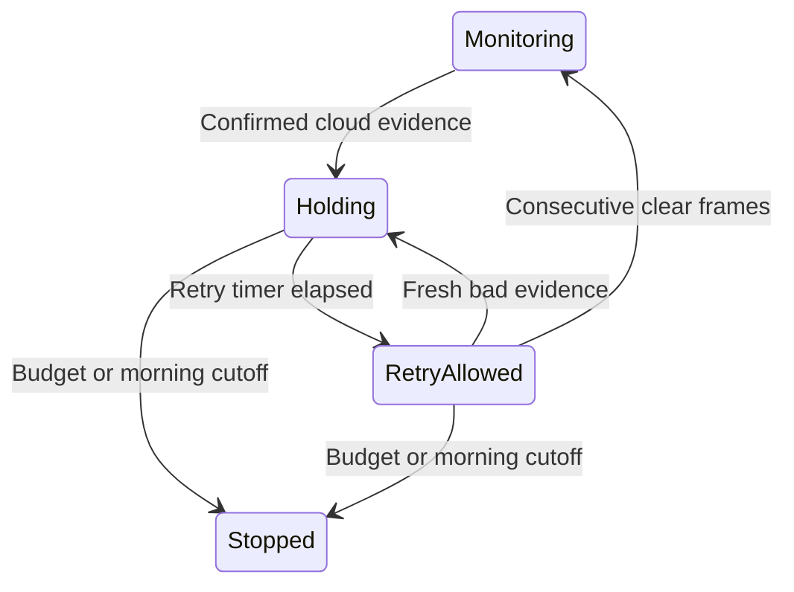

# Cloud guard

Status: first implementation for review, not yet released. Built against NINA 3.2.0.9001. The timer and detector are tested with simulated time; NINA events, safety aggregation, COM threading and themed dialogs are tested with simulated equipment. Physical recovery and a real Target Scheduler session still need validation.

Cloud guard detects degraded imaging conditions and allows periodic trials after a cloud event. It offers a self-contained park/retry trigger or an optional input to the existing Field Kit safety device. The two modes share the same detector and settings.

## Configure the trigger

1. Add **NINA Field Kit → Cloud guard** to the **Triggers** of a parent imaging container in the Advanced Sequencer. Put it above the target instructions, or above the Target Scheduler container. Use one Cloud guard trigger in the running sequence.
2. Choose **Park and retry** or **Report unsafe** before starting. The response mode is locked while armed so two controllers cannot take over the same recovery.
3. Open **Setup**, set the retry delay and episode budget, and check the morning cutoff. Save to the active NINA profile. Detection thresholds are in the expandable section.
4. Enable star analysis for saved light frames. Provide a named deep-sky target with valid coordinates. Target Scheduler supplies its active target through NINA's deep-sky container interface.

Settings are per profile; changing a profile disarms the detector and cancels recovery. References are session-only and reset when the sequence arms. Thresholds/timers can be edited while running without discarding references or clearing an existing episode. A changed retry delay applies to the next hold, not the deadline already in progress. Morning cutoff is calculated when armed; restart the sequence after changing it.

## Park and retry

Leave **Safety Monitor Setup → Cloud guard → Include Cloud guard** disabled. External safety monitors, including Field Kit's normal source aggregation, can still be used.

The trigger observes equipment without issuing commands during normal imaging. When clouds are detected, it waits until the next light-exposure boundary, stops guiding, and parks. The retry delay starts after parking completes. It remains parked until the timer allows a trial and these conditions hold:

- The selected safety monitor permits safety. A configured but disconnected monitor blocks recovery.
- The original profile and named target remain available.
- The target is above the configured minimum altitude and the NINA custom horizon.
- A connected dome reports its shutter open, or reports no shutter.
- The selected morning boundary has not arrived and the episode budget has not expired.

It then unparks and uses NINA's native **Center** operation with the saved planned coordinates and the profile's plate-solving settings. After centering, it restores the saved imaging filter and resumes guiding if guiding was expected. Centering uses snapshot exposures; it does not record additional science frames as completed Target Scheduler work. A failed retry parks again and waits. Cancellation attempts to park; cleanup never unparks. Operation deadlines are passed as cancellation tokens to NINA's equipment APIs, which still depend on drivers honoring cancellation.

Detection during a long exposure remains pending even if the retry timer elapses before that exposure finishes. This mode does not interrupt an active science exposure itself. Keep normal NINA unsafe/meridian-flip handling configured.

## Report unsafe through Field Kit

Choose **Report unsafe** in the trigger. In Field Kit Safety Monitor's **Setup → Cloud guard** tab, enable **Include Cloud guard in the combined safety result**, save, and connect the monitor. It retains the existing device ID and profile settings; its display name is now **Field Kit Safety Monitor**.

Configure your existing unsafe sequence, such as Sequencer+'s unsafe handler, to park and wait for safety before reacquiring the target and guiding. Field Kit does not install that container or issue mount/guider commands in this mode. Keep Cloud guard in a parent container that stays initialized while the unsafe handler waits. If an unsafe handler tears down the trigger, the cloud input becomes disarmed/unsafe and cannot retry until the trigger is armed again.

In Passthrough output mode:

```text
reported safe = every enabled external source permits safety
                AND Cloud guard permits a trial or normal imaging
```

No external sources are required for cloud-only monitoring. If external sources are configured, the cloud timer never overrides their unsafe, stale or failed readings. Existing explicit **Safe / Passthrough / Unsafe** output overrides still apply to the complete result; Safe deliberately bypasses all inputs.

## What the retry timer means

A parked camera has no new science frames with which to establish clear skies. The initial implementation therefore makes the cloud flag safe after a configurable timer. This is permission to **try imaging again**, not a weather measurement.



During **Retry allowed**, the first comparable low-star frame or failed sequence solve holds again. Guiding loss retains its debounce. Fresh frames must have started after the trial began; delayed saves from earlier exposures cannot confirm recovery. By default, two consecutive comparable frames at least 80% of their retained reference confirm recovery and reset the episode budget. Intermediate frames reset clear confirmation; they do not automatically create a new hold unless they cross the low-star threshold.

The episode budget includes parking, waiting, external-safety delays and trial imaging. Repeated evidence, target/filter changes, and unsuccessful retries do not restart it. At expiry, the enclosing Target Scheduler container is skipped; outside Target Scheduler, the nearest deep-sky target container is skipped. At morning, the root sequence's imaging target area is skipped so its end-of-sequence area can run. Report-unsafe mode also performs these container exits but leaves all equipment handling to the unsafe sequence. An enclosing loop must have its own stop condition: this does not change scheduler priorities or prevent an outer loop from re-entering a skipped container.

## Detection and defaults

| Setting | Default | Meaning |
| --- | --- | --- |
| Reference light frames | 3 | Median of positive detected-star counts for each acquisition key. |
| Low star-count fraction | 0.5 | Fewer than 50% of that reference is low. |
| Low-star frames | 3 | Consecutive low frames per key; a good frame resets the streak. |
| Clear confirmation fraction / frames | 0.8 / 2 | Consecutive fresh trial frames confirming recovery. |
| Use guiding detection | On | Only after guiding has actually been observed/started. |
| Guiding lost for | 30 s | Sustained unexpected loss during light imaging. |
| Guide-star loss transitions / window | 3 / 300 s | Repeated loss/recovery, rather than repeated samples of one loss. |
| Failed sequence solves | 2 | Failed native sequencer operations, not internal solver iterations. |
| Allow a retry after | 300 s | Cloud hold before another imaging trial. |
| Stop trying after | 3600 s | Total unresolved episode budget, including trials. |
| Morning cutoff | Nautical dawn | NINA astronomy routines with the profile's observing location. |
| Recovery operation timeout | 180 s | Per park or recenter/restart operation in Park and retry mode. |
| Minimum recovery altitude | 20° | The custom horizon can require a higher altitude. |

The star-count key includes J2000 target coordinates, filter, exposure length, binning, gain, offset, image dimensions, readout mode and camera ID. Interleaved filters keep separate references and low-frame streaks. Calibration frames, missing star analysis, mismatched targets/filters and pre-arm/pre-trial frames do not contribute. Up to 128 acquisition keys are retained. A reference can rise gradually when more stars become visible; it never follows a cloudy decline downward. Three consecutive zero-star frames can cause a hold before a reference exists.

Learning is permissive so a sequence can acquire its initial references; clouds present from the first nonzero frames can produce a weak reference. Without star analysis there is no star-count detection. Guiding-only or solve-only events can still cause a hold. A disarmed, missing or faulted cloud input is unsafe when enabled on the safety device.

Intentional dithering, settling, pause, calibration and looping states are excluded from guiding loss. Unguided sessions are supported. Guider state and guide-step heartbeat are sampled during active light exposures and at frame boundaries. The background observer ticks once per second; it does not poll Alpaca sources or acquire test exposures.

Failed native instructions in `NINA.Sequencer.SequenceItem.Platesolving` feed the solve counter through the root sequence failure event. A successful observed native solve instruction resets it. An instruction can perform several internal attempts before emitting a failure. Background solvers and other plugins' private solving loops are not intercepted. A failure while centering in Cloud guard's own retry is handled directly as a failed recovery.

## Local ASCOM safety sources

In Safety Monitor Setup choose **Add source → Source type → Local ASCOM safety monitor**. Enter the registered SafetyMonitor **ProgID** shown by ASCOM Profile Explorer, rather than a URL or display name. Install a compatible 64-bit ASCOM Platform and driver, and configure the driver using its normal ASCOM setup tool first. This preview does not include an ASCOM chooser or vendor setup button.

**Connect the ASCOM driver when needed? → Yes** is the usual choice. **No** only reads an already-connected driver. Field Kit disconnects a driver during cleanup only if it connected that client itself. Source polling, confirmation counts, missed-check tolerance and safe-age limits work as they do for Alpaca. HTTP-only connection renewal does not apply to COM drivers.

Driver activation, reads and cleanup run on one dedicated STA thread with a dispatcher message pump. A request timeout bounds the caller's wait, not the native COM call. Only one read may be outstanding; timed-out late results are discarded. A stuck driver retains its thread and blocks replacement connections to the same ProgID until it returns. Disposing the source does not block NINA's UI while waiting for COM. These choices avoid concurrent calls and a second driver connection after a timeout; they cannot repair a permanently hung driver.

## Diagnostics and validation

The trigger status, Cloud guard setup and safety integration tab show the phase and reason. Star evidence and retry countdown appear when available. Search NINA's log for **CloudGuard** / **CloudTransition**. The safety diagnostic export includes the cloud snapshot, including target coordinates, when the input is enabled. Endpoint addresses and local driver IDs remain omitted.

Tests cover independent acquisition baselines, initial zero counts, confirmation and debounce, stale image rejection, timer trials, renewed holds, budget and dawn exits, external safety gates, cancellation and re-parking, native image/failure/guider event bridges, profile cleanup, scheduler ancestor selection, MEF/serialization and NINA-themed UI. ASCOM tests use a simulated driver on a real STA dispatcher and cover timeout, late results, connection ownership and replacement exclusion. CI runs them with the existing HTTP fault suite and uploads dialog/trigger renders.

Installed-host validation should check Target Scheduler and the chosen unsafe handler's lifecycle, camera star analysis, the actual guider's state events, parking/cancellation, plate-solve filter restoration, dome following, horizon behavior, and the morning/end-of-sequence flow. This detector does not measure rain, operate a roof, model slew-path clearance, restore rotator framing, or replace an observatory weather source.
